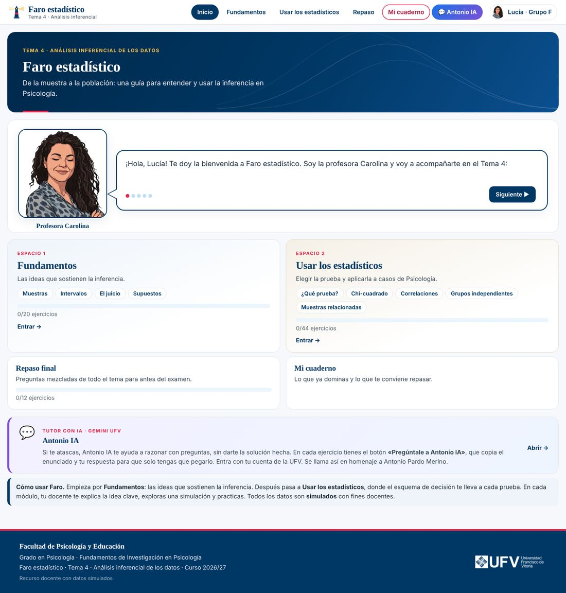
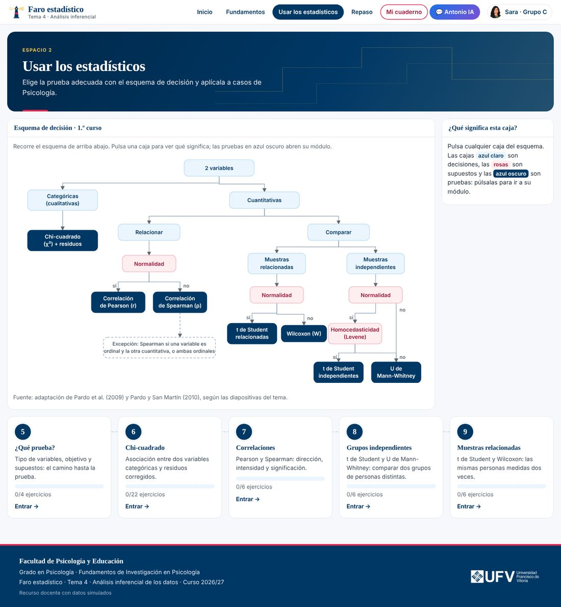
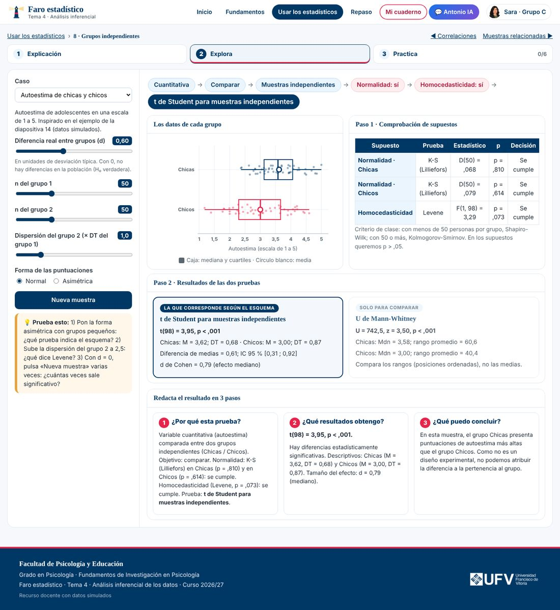
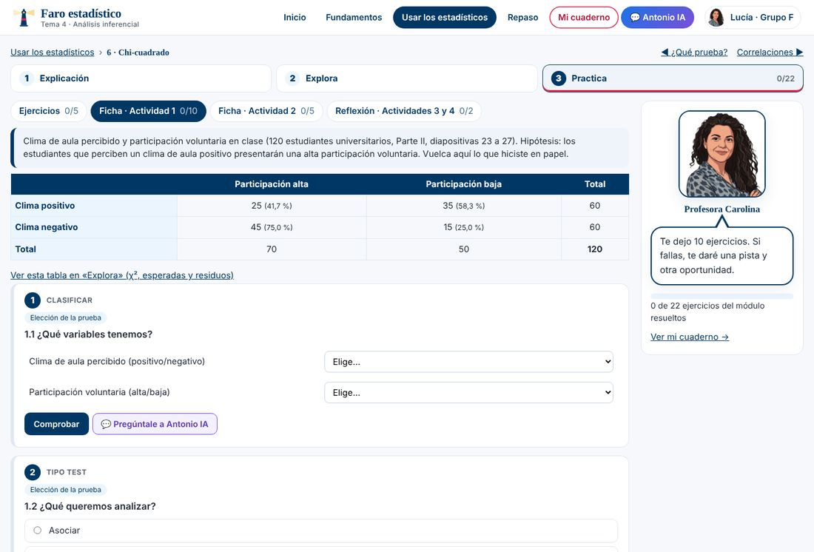
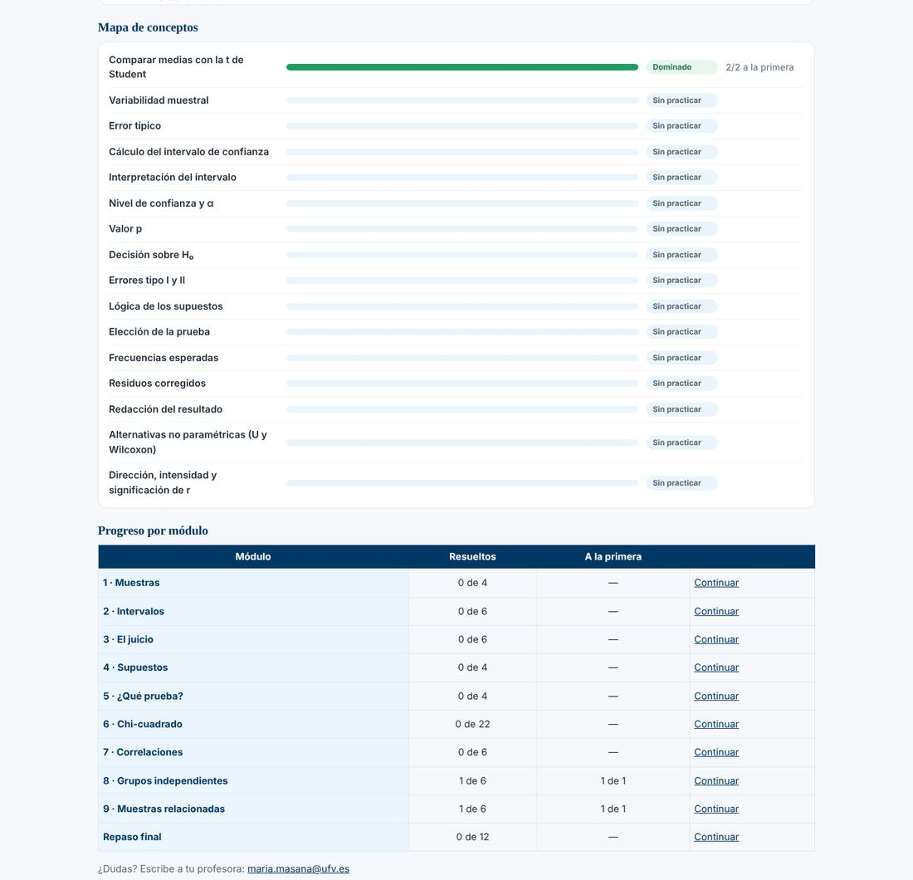

# Faro estadístico

**Tutor interactivo de análisis inferencial para 1.º de Psicología**

[](LICENSE)
[](LICENSE-CONTENIDOS.md)


Faro estadístico acompaña el **Tema 4 · Análisis inferencial de los datos** de la asignatura *Fundamentos de Investigación en Psicología* (Grado en Psicología, Universidad Francisco de Vitoria). Cada docente aparece como avatar animado que explica los conceptos en viñetas de cómic, propone ejercicios basados en los casos de clase, reacciona a las respuestas y, al final, cada estudiante tiene un **cuaderno personal** con lo que domina y lo que le conviene repasar.

> **Todos los datos son simulados** con fines docentes. No proceden de estudios ni de personas reales.



---

## Índice

- [Qué aprende el estudiante](#qué-aprende-el-estudiante)
- [Cómo funciona](#cómo-funciona)
- [Módulos](#módulos)
- [Antonio IA, el tutor socrático](#antonio-ia-el-tutor-socrático)
- [Uso en clase](#uso-en-clase)
- [Instalación y publicación](#instalación-y-publicación)
- [Adaptarlo a otra asignatura o universidad](#adaptarlo-a-otra-asignatura-o-universidad)
- [Estructura del proyecto](#estructura-del-proyecto)
- [Notas técnicas y validación](#notas-técnicas-y-validación)
- [Privacidad](#privacidad)
- [Licencia](#licencia)
- [Cómo citar](#cómo-citar)
- [Referencias](#referencias)

---

## Qué aprende el estudiante

- Por qué una **muestra** varía y qué es el **error típico**.
- Qué significa un **intervalo de confianza**, de dónde sale el 1,96 y qué relación tiene con α.
- La lógica del **contraste de hipótesis** con la analogía del juicio: H₀, valor p, errores tipo I y II.
- Para qué sirven los **supuestos** (normalidad y homocedasticidad) y cómo se comprueban.
- A **elegir la prueba** adecuada con el esquema de decisión de 1.º y a aplicarla:
  chi-cuadrado con residuos corregidos, correlaciones de Pearson y Spearman, t de Student (independientes y relacionadas), U de Mann-Whitney y Wilcoxon.
- A **redactar el resultado en 3 pasos**: por qué esta prueba, qué resultados obtengo y qué puedo concluir.

El enfoque prioriza la comprensión y el razonamiento sobre la aplicación mecánica de fórmulas.

## Cómo funciona

1. **Entrada.** El estudiante escribe su nombre y elige su grupo. Según el grupo, le acompaña el avatar de su docente.
2. **Bienvenida.** El avatar le saluda en un bocadillo de cómic y le explica la herramienta.
3. **Dos espacios:**
   - **Fundamentos:** muestras, intervalos, contraste de hipótesis y supuestos.
   - **Usar los estadísticos:** mapa interactivo del esquema de decisión; cada prueba del mapa abre su módulo.
4. **Tres pasos por módulo:** **Explicación** (el avatar cuenta la idea clave), **Explora** (simulación interactiva con datos generados al momento) y **Practica** (ejercicios tipo test, emparejar, clasificar y completar datos).
5. **Retroalimentación.** Cada ejercicio tiene dos intentos y una pista. El avatar reacciona con cinco expresiones: *hablando*, *esperando*, *celebrando* (acierto), *sorpresa* (acierto tras fallo o racha) y *reflexivo* (fallo con pista).
6. **Mi cuaderno.** Muestra, con el nombre del estudiante, el dominio de 16 conceptos (dominado, repasar, prioritario), sus prioridades con el caso y el apartado que conviene revisar y el progreso por módulo. Se puede imprimir o guardar en PDF.

| Esquema de decisión interactivo | Módulo «Explora» |
|---|---|
|  |  |

| Práctica con ficha de clase | Cuaderno personal |
|---|---|
|  |  |

## Módulos

| Espacio | Módulo | Contenido y ejercicios |
|---|---|---|
| Fundamentos | 1 · Muestras | Variabilidad muestral, error típico, apoyo social |
| | 2 · Intervalos | IC, 1 − α y valor crítico; n = 25 frente a n = 400 |
| | 3 · El juicio | Analogía del juicio, valor p, decisión sobre H₀, errores tipo I y II |
| | 4 · Supuestos | Normalidad (Shapiro-Wilk si n < 50; K-S con Lilliefors si n ≥ 50) y Levene |
| Usar los estadísticos | 5 · ¿Qué prueba? | Esquema de decisión: tipo de variables, objetivo y supuestos |
| | 6 · Chi-cuadrado | Calculadora de tablas 2 × 2 a 3 × 3, frecuencias esperadas, residuos corregidos (±1,96); fichas de las actividades de clase |
| | 7 · Correlaciones | Pearson y Spearman: dirección, intensidad y significación |
| | 8 · Grupos independientes | t de Student y U de Mann-Whitney elegidas con el esquema; d de Cohen |
| | 9 · Muestras relacionadas | t para muestras relacionadas y Wilcoxon; normalidad de las diferencias |
| | Repaso final | 12 preguntas mezcladas de todo el tema |

**Criterios de clase aplicados:** α = ,05; residuos significativos fuera de ±1,96; intensidad de r con cortes en ,10 / ,30 / ,50 / ,70; en muestras independientes sin normalidad se usa directamente la U de Mann-Whitney.

## Antonio IA, el tutor socrático

**Antonio IA** es un Gem de Google Gemini que ayuda a razonar con preguntas, sin dar la solución hecha. Su nombre es un homenaje a **Antonio Pardo Merino**, referente de la enseñanza del análisis de datos en España.

- Está en el botón morado de la cabecera, en una tarjeta de la portada y en cada ejercicio.
- El botón **«Pregúntale a Antonio IA»** copia el contexto del módulo, el enunciado, la respuesta del estudiante y la pista, y abre el Gem en otra pestaña para pegarlo.
- Se accede con la cuenta institucional de Gemini.

`docs/gem_tutor_tema4.md` contiene las instrucciones del Gem (Parte A), su base de conocimiento (Parte B) y notas para el profesorado (Parte C). Para crear tu propio Gem, pega las partes A y B en Gemini y cambia la URL en `js/contenido.js`.

## Uso en clase

Enlaces directos (añádelos al final de la URL publicada):

| Enlace | Abre |
|---|---|
| `#fundamentos` · `#estadisticos` | Cada espacio |
| `#chi/practica/act1` · `#chi/practica/act2` | Fichas de las actividades de chi-cuadrado para comprobar lo hecho en papel |
| `#chi/explora` | Calculadora de chi-cuadrado con las actividades precargadas |
| `#independientes/explora` · `#relacionadas/explora` | Simulaciones de comparación de medias |
| `#<módulo>/<paso>` | Cualquier módulo: `muestras`, `intervalos`, `juicio`, `supuestos`, `esquema`, `chi`, `correlaciones`, `independientes`, `relacionadas`, `repaso`, `cuaderno`; pasos `explica`, `explora`, `practica` |

Sugerencia de dinámica: resolver la actividad en papel en clase, comprobarla después en la ficha de la herramienta y dejar el resto de ejercicios y el cuaderno como trabajo autónomo.

## Instalación y publicación

Es una **web estática**: no necesita servidor, instalación ni conexión a internet (salvo para Antonio IA).

**En local:** descarga el repositorio y abre `index.html` en el navegador.

**Con GitHub Pages:**

1. Sube el contenido del repositorio a GitHub.
2. Ve a **Settings → Pages**.
3. En *Build and deployment*, elige **Deploy from a branch**, rama `main` y carpeta `/ (root)`.
4. En uno o dos minutos estará en `https://<usuario>.github.io/<repositorio>/`.

**Versión Shiny (opcional).** La carpeta `shiny/` contiene la versión original en R, sin avatares:

```r
install.packages(c("shiny", "bslib", "ggplot2", "nortest"))
shiny::runApp("shiny")
```

## Adaptarlo a otra asignatura o universidad

Todo el contenido editable está en **`js/contenido.js`**:

- `DOCENTES` y `GRUPOS`: docentes, correo, género gramatical y grupos.
- `GEM`: URL y nombre del tutor de IA.
- `MODULOS`, `REACCIONES`, `BIENVENIDA`: diálogos del avatar.
- `CONCEPTOS` y `PRACTICA`: conceptos del cuaderno y ejercicios.

Los textos usan fichas que se adaptan al docente: `{la}` / `{La}`, `{profe}` / `{Profe}`, `{contenta}`, `{orgullosa}`, `{docente}` y `{alumno}`.

**Avatares.** Guarda las animaciones en `img/avatares/` como `<avatar>-<expresión>.webp` (expresiones: `hablando`, `esperando`, `celebrando`, `sorpresa`, `reflexivo`, más una imagen fija `<avatar>-reposo.webp`). Formato recomendado: 320 × 320 px, fondo blanco. Si falta una expresión, añádela a `faltan` y se mostrará la imagen fija. Para usar un GIF, indícalo en `ext` (por ejemplo, `ext: { esperando: "gif" }`).

**Identidad institucional.** Cambia el logotipo y el pie en `index.html` y los colores en las variables de `css/estilos.css`.

> Los logotipos de la UFV y los avatares de los docentes **no** tienen licencia libre: sustitúyelos si reutilizas el proyecto (ver [Licencia](#licencia)).

## Estructura del proyecto

```
index.html              Página principal
css/estilos.css         Estilos (colores institucionales UFV)
js/estadistica.js       Distribuciones y pruebas estadísticas (validadas con R)
js/graficos.js          Mini-librería de gráficos SVG
js/contenido.js         ← EDITABLE: docentes, grupos, diálogos, conceptos y ejercicios
js/app.js               Simulaciones de cada módulo («Explora»)
js/tutor.js             Avatares, viñetas, ejercicios, mapa del esquema y cuaderno
img/avatares/           Animaciones de los docentes (WebP)
img/faro.svg            Icono de la herramienta
docs/gem_tutor_tema4.md Instrucciones y conocimiento del Gem Antonio IA
docs/revision_items_tema4.md  Revisión de calidad de los ítems tipo test
docs/capturas/          Capturas para este README
shiny/                  Versión original en R/Shiny
```

## Notas técnicas y validación

- **Sin dependencias externas.** Cálculos y gráficos están programados en JavaScript puro; funciona abriendo el archivo directamente.
- **Resultados validados con R.** La librería `js/estadistica.js` reproduce:
  - `t.test(var.equal = TRUE)` y `t.test(paired = TRUE)`;
  - `wilcox.test(exact = FALSE, correct = FALSE)` para la U de Mann-Whitney y Wilcoxon, con corrección por empates;
  - `chisq.test(correct = FALSE)` con residuos corregidos (`stdres`);
  - `shapiro.test` (algoritmo de Royston) y `nortest::lillie.test`;
  - Levene centrada en la media (como SPSS);
  - `cor.test` para Pearson y Spearman (aproximación t).
- **Ítems revisados:** opciones homogéneas en longitud y forma, y orden aleatorio de las opciones en cada carga (ver `docs/revision_items_tema4.md`).
- **Accesibilidad:** navegación con teclado en tarjetas y mapa, y una imagen fija del avatar cuando el sistema pide reducir el movimiento (`prefers-reduced-motion`).
- **Diseño adaptable** a móvil y tableta.

## Privacidad

El progreso se guarda **solo en el navegador del estudiante** (`localStorage`); no se envía a ningún servidor ni se recogen datos. Desde el cuaderno se puede guardar una copia del progreso (JSON) y cargarla en otro ordenador. Antonio IA funciona fuera de la herramienta, en la cuenta de Gemini del estudiante.

## Licencia

- **Código** (`.html`, `.css`, `.js`, `.R`): [MIT](LICENSE).
- **Contenidos docentes** (explicaciones, ejercicios, casos y documentación): [CC BY-SA 4.0](https://creativecommons.org/licenses/by-sa/4.0/deed.es).
- **Excluidos:** logotipos de la Universidad Francisco de Vitoria (marca registrada) y avatares de los docentes (todos los derechos reservados, usados con autorización).

Detalles en [LICENSE-CONTENIDOS.md](LICENSE-CONTENIDOS.md).

## Cómo citar

> Ramírez, E. (2026). *Faro estadístico: tutor interactivo de análisis inferencial para 1.º de Psicología* (Versión 1.0) [Software]. Universidad Francisco de Vitoria. https://github.com/Eduar-Ramirez/faro-estadistico

También puedes usar el botón «Cite this repository» de GitHub (archivo `CITATION.cff`).

## Referencias

El esquema de decisión es una adaptación de:

- Pardo, A., Ruiz, M. Á., & San Martín, R. (2009). *Análisis de datos en ciencias sociales y de la salud I* (2.ª ed.). Síntesis.
- Pardo, A., & San Martín, R. (2010). *Análisis de datos en ciencias sociales y de la salud II* (2.ª ed.). Síntesis.

## Autoría

**Eduar Ramírez** · Facultad de Psicología y Educación · Universidad Francisco de Vitoria.

Avatares y voz de la herramienta: profesorado de la asignatura (Miriam Granado Peinado, María Masana, Eduar Ramírez y Carolina Martín).

Material desarrollado con apoyo de Claude (Anthropic).
